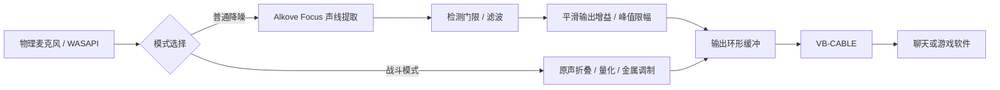

# KeepQuiet

<p align="center">
  <strong>面向 Windows 语音聊天的本地目标声线提取与虚拟麦克风工具</strong><br>
  目标声线提取 · WASAPI 设备接口 · 启动自动测速 · 黑白双主题
</p>

<p align="center">
  
  
  
  
  
  
  
  
</p>

---

## 💡 设计初衷

宿舍、办公室或家庭环境中的语音聊天，常会混入旁人说话、电视、键盘等声音。常规降噪不一定能区分使用者与旁人的声音。

KeepQuiet 使用录入的个人声纹作为目标说话人提取的条件，尝试保留匹配声线的声音，抑制非目标人声与背景杂音。默认录入流程提供中文朗读提示、3 秒倒计时和 6 秒录音，并检查有效语音、削波及前后声线一致性。

**提取效果取决于声线录入质量、麦克风位置、多人声音重叠和房间混响，不能保证完全消除旁人说话或环境声。**

## ✨ 核心特性

- **Alkove Focus 目标声线提取**：集成 Alkove 0.4.0。普通运行使用 Focus；声线录入时使用 Cue 检测有效语音片段，使用 Timbre 提取声纹并检查前后声线一致性。
- **本地音频处理与声纹加密**：音频处理在本地 CPU 执行。声纹通过 Windows DPAPI 绑定当前系统用户加密保存，默认数据目录为 `%LOCALAPPDATA%\KeepQuiet\`。依赖安装、模型获取和驱动版本检查可能需要网络。
- **开始运行时测速，切换模式复用线路**：每次点击“开始运行”都先测速并复验，再开启输出。运行中切换档位、滤波或战斗模式时，沿用本次线路重新初始化处理链，不重复测速；保留静音、已启用的耳返及普通模式参数。停止运行后可手动重新测速。
- **普通降噪与独立战斗模式**：普通模式提供自然、均衡、强效三档及自定义设置；战斗模式绕过降噪模型，对麦克风原声使用波形折叠、粗量化和金属调制，产生电流与撕裂失真。战斗效果不使用普通模式的门限、滤波和增益参数。
- **音频控制与状态显示**：自定义窗口可调检测下限、输出增益和普通／强效滤波。提供静音、耳返自测、输入／输出电平，以及按整机总逻辑处理器口径计算的应用 CPU 占用。
- **异常处理**：输出增益带平滑处理及峰值限幅；异常配置会备份，保留有效项并恢复无效项；检测到严重音频故障时停止输出。
- **紧凑界面与托盘运行**：760×360 固定窗口、黑白双主题，关闭窗口后保留在系统托盘。运行中切换到自定义时，参数窗口保持显示，处理链切换期间暂时禁用控件。

普通降噪模式需要先录入声线。战斗模式不需要声纹，也不会过滤周围声音；启用后纯净度栏呈红色并锁定。

## 🏗️ 音频链路



Qt 界面与音频任务运行在独立进程中，IPC 传递控制命令、状态与统计，不通过 UI 传送麦克风 PCM。这样可以降低界面卡顿对音频处理的影响，实际稳定性仍取决于设备和系统负载。

音频工作进程会尝试提升进程优先级并申请 **MMCSS Pro Audio** 调度；设置失败时会报告状态，不保证所有机器都能成功启用。

## 🚀 普通用户：使用便携成品

无需安装 Python 或编译环境。

1. 在本仓库 **[Releases](../../releases)** 下载 `KeepQuiet-0.2.2-win-x64.zip`，完整解压后运行 `KeepQuiet/KeepQuiet.exe`。
2. 打开“设备管理”，检查 VB-CABLE。若未安装，可手动点击“安装 / 更新”；需要管理员权限，完成后可能需要重启。
3. KeepQuiet 输入选择物理麦克风的 **WASAPI** 项，输出选择 **CABLE Input (VB-Audio Virtual Cable)** 的 WASAPI 项。在聊天或游戏软件中，将麦克风输入设为 **CABLE Output (VB-Audio Virtual Cable)**。
4. 普通模式先点击“录入声线 / 6 秒”，在弹窗中点击“开始录入”，倒计时后自然朗读提示语。录入成功后可先选择“均衡”，点击“开始运行”。
5. 等待自动测速完成，通过“耳返自测”检查声音。关闭窗口会保留在托盘，彻底退出请使用托盘菜单。

线路方向为：**物理麦克风 → KeepQuiet → CABLE Input → VB-CABLE → CABLE Output → 聊天或游戏软件**。

VB-CABLE 是 **VB-Audio / Vincent Burel** 的独立 Donationware 产品，欢迎支持其开发：[官方网站](https://www.vb-cable.com/) · [许可与支持](https://vb-audio.com/Services/licensing.htm) · [支持／购买许可](https://shop.vb-audio.com/en/win-apps/11-vb-cable.html)。本项目保留原始基础驱动包，不包含 A+B、C+D。

## 🛠️ 开发者：从源码运行与构建

### 环境

- Windows x64；当前本地验证环境为 Windows 11。
- 已验证 Python **3.12**。
- 使用 Windows PowerShell 5.1 或兼容的 PowerShell 环境。

### 配置并启动

在项目根目录执行：

```powershell
# 创建虚拟环境，安装主要直接依赖的固定版本，并校验模型
powershell -NoProfile -ExecutionPolicy Bypass -File scripts/Setup.ps1

# 从源码启动
powershell -NoProfile -ExecutionPolicy Bypass -File scripts/Start-KeepQuiet.ps1
```

### 测试

当前本地完整测试为 **127 项通过**，另有 **66 项原生界面检查通过**。GitHub CI 配置选择其中 126 项 pytest 测试，排除依赖宿主真实音频端点的一项；远程 Actions 尚需首次推送后验证。

```powershell
.\.venv\Scripts\python.exe -B -m pytest -q -p no:cacheprovider
```

无真实音频端点机器的命令、原生界面检查及验证范围见 [构建指南](docs/BUILD.md) 和 [验证说明](docs/VALIDATION.md)。

### 构建成品

```powershell
powershell -NoProfile -ExecutionPolicy Bypass -File scripts/Build.ps1 -OutputDirectory dist-github
```

构建脚本先运行测试，再生成单目录应用、安装脚本、许可说明、成品 ZIP、Qt/PySide 对应源码 ZIP 与校验文件。首次获取对应源码需要网络；源码来自固定官方 URL，并按固定 SHA256 验证，缓存位于 `build/qt-sources-cache/`。

主要直接依赖已固定版本；完整传递依赖、工具链和 Python 补丁版本尚未全部锁定，不应将其视为字节级可复现构建。

## 📦 发布附件

发布者将在同一个 GitHub Release 提供：

| 文件 | 用途 |
| --- | --- |
| `KeepQuiet-0.2.2-win-x64.zip` | 用户下载运行的 Windows 成品 |
| `KeepQuiet-Qt-PySide-6.12.0-source.zip` | 当前成品所用 Qt/PySide 对应源码、原始许可及构建／替换说明 |

**在分发对应成品期间，保持 Qt/PySide 源码附件与获取指引可用。** 普通用户运行程序只需下载成品 ZIP，无需同时下载源码附件。

`KeepQuiet-0.2.2-source.zip` 是本项目源码的压缩备份，可选添加。GitHub 仓库根目录应放本项目源码文件夹内部内容；Qt/PySide 的大型源码附件放 Releases，无需提交进 Git 仓库。

## 📁 源码目录

```text
KeepQuiet/
├── .github/                    # CI 与 Issue / PR 模板
├── assets/                     # 应用图标
├── docs/                       # 架构、构建和验证文档
│   └── images/                 # 黑白主题与战斗模式截图
├── keepquiet/                  # UI、音频、模式、配置与工作进程
├── models/                     # Alkove 模型、来源及原始许可
├── scripts/
│   ├── Setup.ps1               # 配置源码运行环境
│   ├── Start-KeepQuiet.ps1      # 启动
│   ├── Build.ps1               # 测试、打包及生成发布附件
│   ├── Prepare-QtSources.py    # 获取并校验对应 Qt/PySide 源码
│   └── Install-KeepQuiet.ps1   # 成品的可选用户安装
├── tests/                      # 127 项自动化测试与公开样本
├── vendor/
│   ├── licenses/              # 第三方原始许可与版权声明
│   ├── redistribution/        # Qt/PySide 来源、许可与替换说明
│   └── vbcable/               # 原始基础驱动包与声明
├── LICENSE                     # 原创代码 MIT 许可
├── LICENSE_STATUS.md           # 许可适用范围
├── THIRD_PARTY_NOTICES.md       # 第三方组件声明
├── pyproject.toml              # 项目元数据与依赖
└── KeepQuiet.spec              # PyInstaller 单目录打包配置
```

音频模块与 IPC 设计见 [架构说明](docs/ARCHITECTURE.md)，更新记录见 [CHANGELOG](CHANGELOG.md)。

## ⚠️ 已知边界

1. **分离质量**：多人重叠、声线相近、强混响、耳语与快速弱音仍可能导致串音、目标声音损伤或断续。现有公开样本测试不等于真实中文多人场景已达到预期纯净度。
2. **延迟与性能**：线路测速反映本机设备及处理链的测量／估算，不包含完整游戏捕获、编码与网络链路。CPU 和稳定性依赖目标电脑及游戏负载。切换模式会短暂重启处理链，沿用旧线路不代表重新验证了切换后的负载。
3. **兼容性**：没有验证各款聊天软件、游戏或反作弊系统的完整兼容性，不承诺使用不会触发游戏限制。长时间运行和热插拔仍需目标电脑实测。
4. **战斗模式**：这是原声失真效果，周围人声与环境声也会进入效果，不用于目标声线分离。
5. **发布环境**：当前成品内置 Python 3.12.10，运行时安全更新仍需后续评估；EXE 未签名，Windows 可能显示未知发布者提示。

## 📜 许可与第三方组件

**KeepQuiet 原创代码与原创文档采用 [MIT 许可](LICENSE)**，范围见 [LICENSE_STATUS.md](LICENSE_STATUS.md)。

第三方组件继续遵循各自许可，MIT 不对它们重新授权：

- **Alkove 0.4.0**：保留 Apache-2.0 许可及上游声明。
- **Qt / PySide6 / Shiboken6 6.12.0**：本次对提供 LGPL 选项的已分发组件选择 LGPLv3；其中第三方代码保留各自许可。14 个保留库文件已与官方 Windows wheel 逐字节核对，对应完整源码与构建／替换说明作为 Release 附件提供。
- **VB-CABLE**：VB-Audio 的独立 Donationware 产品，遵循供应商条款，原始基础包保持不变。
- **NumPy、SoundDevice、PortAudio、Psutil、CFFI、CPython、PyInstaller 等**：保留各自的原始许可及声明。

软件内 **“设备管理 → 维护 → 开源许可”** 可离线查看许可文本、第三方声明、源码来源与动态库替换说明。

详见 [第三方声明](THIRD_PARTY_NOTICES.md)、[Qt/PySide 分发说明](vendor/redistribution/QT_PYSIDE_NOTICE.md)、[构建与动态库替换指南](vendor/redistribution/REBUILD_AND_REPLACE.md)。
