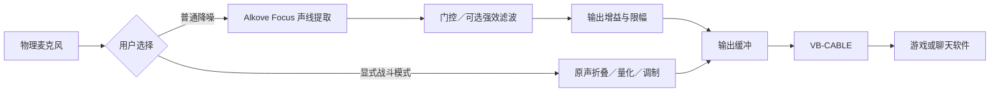

# 架构

UI 使用 PySide6；模型、音频和驱动操作在独立 spawn 工作进程执行。IPC 传递控制命令、状态和统计，不通过 UI 传送麦克风 PCM。

普通模型按 16 kHz 内部节拍工作，必要时转换为输出采样率。战斗模式保持原声采样率，使用独立效果参数。普通门限与增益不参与战斗效果。

每次启动先测速及复验，再打开正式输出。档位／模式／滤波切换通过停止旧进程、沿用本次启动线路并启动新进程实现，不重新测速，静音在新进程产生音频前恢复。准备阶段锁定参数。手动门限与增益可实时更新。

主要模块：ui.py（界面及生命周期）、worker.py（工作进程）、audio.py（音频桥与环形缓冲）、battle.py（原声失真）、gate.py/gain.py（普通后处理）、benchmark.py（路线测量）、devices.py（端点身份）、driver.py（供应商包校验与安装）、storage.py（配置与 DPAPI 声纹）。

默认数据目录为当前 Windows 用户的 LocalAppData/KeepQuiet；测试使用临时 KEEPQUIET_DATA_DIR。不要把运行时数据作为源码提交。
